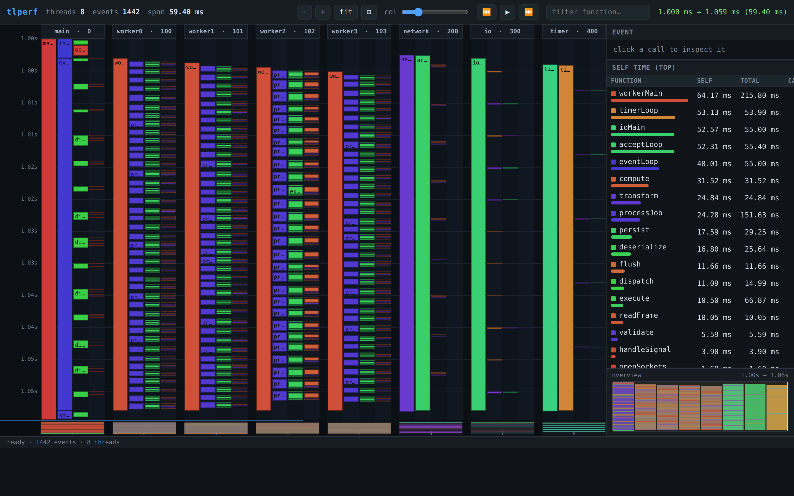
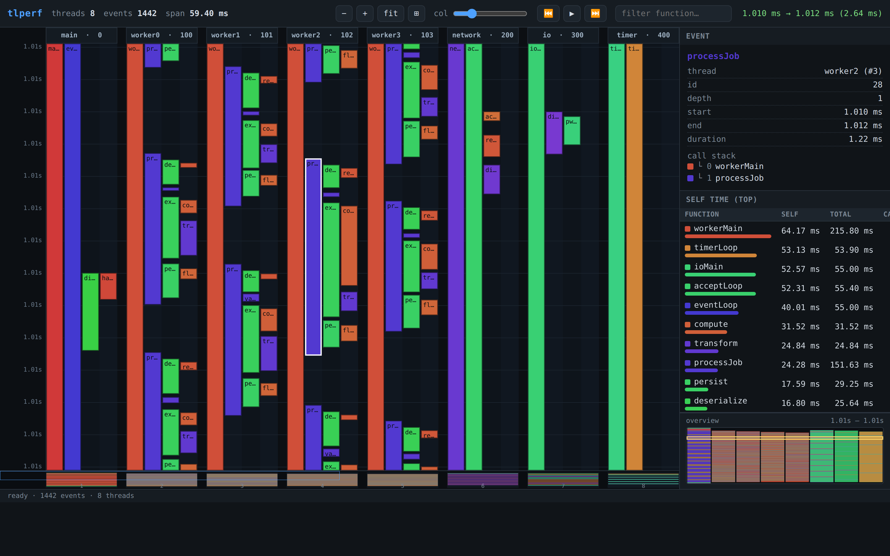
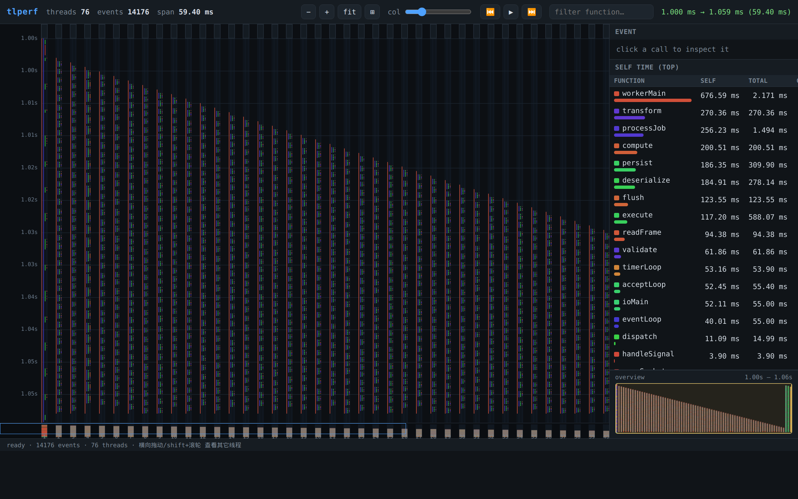

# tlperf

轻量级 **per-thread 时序性能分析器**（demo）。

| 全 trace 概览（大列 = 线程，行 = 时间轴） | 放大某个时间窗口 + 选中事件 |
|:---:|:---:|
|  |  |

**72 线程**：内容比视口宽，可横向平移 / 调小列宽 / 用底部线程导航条浏览（只画可见线程）。

| 76 线程 / 1.4 万事件（`tlperf-demo -t 72`） |
|:---:|
|  |

- **采样库**：`tlperf.h` + `libtlperf.a` —— 给项目插桩，采集每个线程的调用栈
  （函数名、开始/结束时间，单位 us），输出二进制文件 `tlperf.data`。
- **分析后端**：`tlperf-server`（C++ + [cpp-httplib](third_party/httplib.h)）—— 读取
  `tlperf.data`，提供 HTTP/JSON 接口，并挂载前端页面。
- **前端**：`web/`（原生 JS + Canvas）—— 时序瀑布图：
  - **大列 = 线程**（每列一个 thread）
  - **小列 = 调用深度**（嵌套子函数逐层缩进）
  - **行 = 时间轴**（上下拖动时间窗口 / 滚轮缩放 / 小地图概览）

## 目录结构

```
tlperf.h                 # 公共头（采样 API + 二进制格式说明 + readData）
CMakeLists.txt
src/tlperf.cpp           # 采样实现（线程本地状态 + 全局函数名表）
src/tlperf-server.cpp    # 分析后端（httplib，JSON API）
demo/tlperf-demo.cpp     # 生成合成数据（replay 模式）/ 真实时钟采样（-l）
web/index.html           # 前端页面
web/app.js               # 前端逻辑（Canvas 时序图、拖动、缩放、自检表）
third_party/httplib.h    # cpp-httplib（header + 共享库）
third_party/libcpp-httplib.so.0
```

## 构建

```sh
mkdir -p build && cd build
cmake .. -DCMAKE_BUILD_TYPE=Release
make -j
```

产物：
- `build/lib/libtlperf.a` + `tlperf.h`  —— 交付给项目的采样库
- `build/bin/tlperf-demo`               —— 生成 `tlperf.data` 的示例
- `build/bin/tlperf-server`             —— 分析服务器

## 使用（3 步）

```sh
# 1) 生成一个 tlperf.data（demo 会造一个 8 线程、1400+ 事件的仿真 trace）
./build/bin/tlperf-demo -o tlperf.data
# 想要超多线程看横向浏览效果： -t 72  -> 76 线程 / 1.4 万事件
./build/bin/tlperf-demo -o tlperf72.data -t 72

# 2) 启动分析服务器（前端 + JSON API）
./build/bin/tlperf-server -d tlperf.data -w web -p 8080

# 3) 浏览器打开
open http://127.0.0.1:8080
```

### 在自己的项目里插桩

```cpp
#include "tlperf.h"
#include <thread>

int main() {
    tlperf::Sampler::instance().setOutput("tlperf.data");

    // 每个要采样的线程：注册一次
    std::thread worker([] {
        tlperf::Sampler::instance().registerThread("worker");

        tlperf::Sampler::instance().begin("handleRequest");   // us，自动取钟
        tlperf::Sampler::instance().begin("parse");
        tlperf::Sampler::instance().end("parse");
        tlperf::Sampler::instance().end("handleRequest");

        tlperf::Sampler::instance().unregisterThread();
    });
    worker.join();

    tlperf::Sampler::instance().dump();   // 写 tlperf.data
}
```

更简洁地用 RAII：

```cpp
tlperf::Scope s("handleRequest");   // 构造 begin，析构 end
{
    tlperf::Scope s2("parse");
}
```

### 手动时间戳（replay / 外部采样器）

如果你的调用栈来自外部（例如已有 start/end us 的记录），可直接喂数据，
按 `threadId` 分组即可（无需真实 OS 线程）：

```cpp
using S = tlperf::Sampler;
S::instance().begin("processJob", 1000, 1, "worker1");
S::instance().begin("parse",      1040, 1, "worker1");
S::instance().end  ("parse",      1160, 1);
S::instance().end  ("processJob", 1300, 1);
S::instance().dumpTo("tlperf.data");
```

## 前端操作

| 操作 | 效果 |
|------|------|
| **上下拖动**画布 | 平移时间窗口（行 = 时间轴） |
| **滚轮** | 以鼠标处为锚点缩放 |
| 右下 **小地图** 拖动 | 全局概览、跳转 |
| `+/−/fit` | 缩放 / 适配整条 trace |
| `▶` | 播放（时间窗口横扫） |
| 搜索框 | 高亮/过滤函数名 |
| 点击某个调用块 | 右侧显示该事件详情 + 完整调用栈 |
| 右侧 **self time** 表 | 按独占时间排序的函数热点；点击行可在图上高亮该函数 |
| URL 参数 | `?from=US&to=US` 定位窗口；`?sel=线程:事件id` 预选事件（可分享/复现视图，见上图） |

**超多线程（如 72+）**：大列过多时内容宽度超出视口，用以下方式浏览——
- **shift + 滚轮** 或 **水平滚轮** / **方向键 ←→** / **底部线程导航条**（点按拖动）平移线程列；
- **col 滑块** 手动调小“深度列宽”，**⊞** 按钮把所有线程压缩进当前宽度；
- 只绘制视口内的线程（**culling**），命中检测按列网格 **O(1)**，小地图/导航条**预渲染**后直接 blit，
  因此帧成本约等于“可见线程 × 可见事件”，线程再多也不卡（76 线程 / 1.4 万事件实测流畅）。

- **self（独占）时间** = 帧时长 − 直接子帧时长之和（真正花在该函数上的时间）。
- **total（累计）时间** = 该名字所有帧的原始时长之和（含子帧）。

## JSON API

| 接口 | 返回 |
|------|------|
| `GET /api/info` | `{version, threadCount, eventCount, minUs, maxUs, totalUs, functions}` |
| `GET /api/threads` | `[{i, threadId, name, eventCount}]` |
| `GET /api/summary` | `[{i, name, selfUs, totalUs, callCount, avgUs}]`（按 self 降序） |
| `GET /api/events?from=&to=&thread=` | `[{t, i, f, p, d, s, e, n}]`（窗口内、按线程） |

`t`=线程下标 `i`=事件id `f`=函数id `p`=父事件id（同线程内，-1=根）`d`=嵌套深度
`s/e`=开始/结束(us) `n`=函数名

## 二进制格式（tlperf.data，little-endian）

```
Header      : "TLPERF\0\0"(8) uint32 version, uint32 threadCount, uint64 eventCount
Threads     : [threadCount×] uint64 threadId, uint32 nameLen, uint32 eventCount, char name[nameLen]
Events      : [eventCount ×] uint64 threadIdx, uint32 funcId, int32 parentId, uint64 startUs, uint64 endUs
Functions   : uint32 funcCount, [funcCount×] uint32 nameLen, char name[nameLen]
```

`parentId` 是**同线程内**的事件下标（-1 为根）；`funcId` 指向 Functions 表。

## 生成 demo 截图（可选）

```sh
./build/bin/tlperf-demo -o tlperf.data
./build/bin/tlperf-server -d tlperf.data -w web -p 8080 &
google-chrome-stable --headless=new --no-sandbox --hide-scrollbars \
  --force-device-scale-factor=2 --window-size=1440,900 --virtual-time-budget=6000 \
  --screenshot=web/screenshot-full.png "http://127.0.0.1:8080/"
google-chrome-stable --headless=new --no-sandbox --hide-scrollbars \
  --force-device-scale-factor=2 --window-size=1440,900 --virtual-time-budget=6000 \
  --screenshot=web/screenshot.png "http://127.0.0.1:8080/?from=1010000&to=1012500&sel=3:28"
```

## 说明 / 边界

- 采样基于 `std::chrono::steady_clock`；热路径为每线程本地栈 + 单把全局锁
  （仅在“函数名首次出现”和 `dump()` 时争用）。
- `end(name)` 匹配**最近一层**未闭合的同名 `begin`（LIFO）。
- 需要事件满足嵌套约束（子帧完全落在父帧区间内），否则 self/depth 分析会失真——
  正常 begin/end 插桩天然满足；replay 数据需保证该约束。
- cpp-httplib 0.10.3（Ubuntu 包为声明头 + 共享库 `libcpp-httplib.so.0`，已 vendor
  到 `third_party/` 并写入 rpath）。
